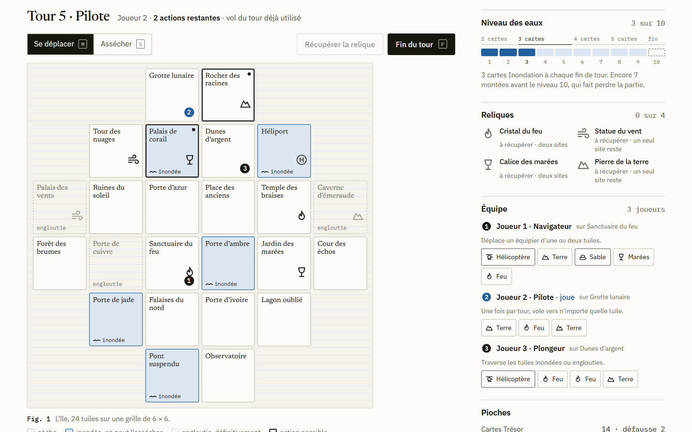
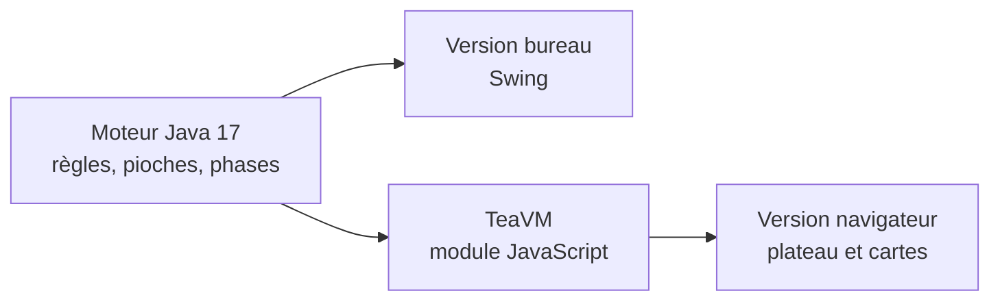

<p align="center">
  
</p>

<h1 align="center">L'Île interdite</h1>

<p align="center">
  Une adaptation numérique du jeu de plateau coopératif, de 2 à 4 joueurs sur le même écran,<br>
  avec un moteur Java partagé entre la version bureau et la version navigateur.
</p>

<p align="center">
  <a href="https://badreddine05.github.io/ile-interdite/"><strong>Jouer dans le navigateur</strong></a>
  &nbsp;·&nbsp;
  <a href="docs/ENGINE.md">Les règles du moteur</a>
  &nbsp;·&nbsp;
  <a href="https://badreddine05.github.io/">Portfolio</a>
</p>

<picture>
  <source media="(prefers-color-scheme: dark)" srcset=".github/readme/ile-interdite-dark.png">
  
</picture>

## Le jeu

L'île compte 24 tuiles et s'enfonce un peu plus à chaque tour. L'équipe doit récupérer les quatre reliques, se réunir sur l'héliport et s'envoler avant d'être engloutie. Tout le monde gagne ou perd ensemble, et les mains de cartes sont visibles de tous.

À son tour, un aventurier dispose de trois actions : se déplacer, assécher une tuile inondée, donner une carte relique ou récupérer une relique. Il pioche ensuite deux cartes Trésor, puis des tuiles sont inondées. Une tuile inondée peut être asséchée ; une tuile engloutie disparaît pour de bon. Les cartes « montée des eaux » accélèrent l'inondation, et la partie est perdue si l'héliport sombre, si les deux sites d'une relique encore à prendre disparaissent, si l'eau atteint le dernier niveau ou si un aventurier ne peut plus nager vers une tuile sûre.

Chaque aventurier a un talent :

| Rôle | Talent |
| --- | --- |
| Exploratrice | Se déplace, assèche et nage aussi en diagonale |
| Ingénieur | Assèche deux tuiles pour une seule action |
| Pilote | Vole une fois par tour vers n'importe quelle tuile |
| Plongeur | Traverse les tuiles inondées ou englouties en une action |
| Messagère | Donne une carte relique à un équipier, où qu'il soit |
| Navigateur | Déplace un autre joueur d'une ou deux tuiles |

Cette édition annonce deux simplifications dans son aide : les sauvetages se résolvent avant les cartes spéciales, et l'Ingénieur assèche au plus deux tuiles d'affilée.

## Commandes

- À la souris ou au doigt : choisir une action, puis cliquer une tuile surlignée. Les cartes en main se cliquent aussi, pour donner une relique, utiliser l'hélicoptère (passagers puis destination) ou les sacs de sable, et défausser quand la main est pleine.
- Au clavier : Tab pour atteindre le plateau, les flèches pour passer d'une tuile à l'autre, Entrée ou Espace pour agir. M déplace, S assèche, N guide un équipier (Navigateur), F finit le tour, P met en pause et Échap annule une carte en cours.
- Une nouvelle expédition se règle avec 2 à 4 joueurs, un niveau d'eau de départ de 1 à 4 et une graine facultative. La partie est enregistrée après chaque coup et reprise au retour ; elle peut aussi être exportée en JSON.

## Comment c'est construit



Toutes les règles vivent dans une seule classe, `Engine`, sans interface, réseau ni horloge. Une graine et une suite de commandes déterminent entièrement la partie. L'interface ne décide jamais si une action est permise : elle propose les coups que le moteur déclare possibles, puis lui laisse valider la commande.

Les tests couvrent les coûts d'action, les six rôles, les limites de main, la montée des eaux, la disparition des tuiles, les cartes spéciales, la victoire et les quatre conditions de défaite. Cent parties à graine fixe sont simulées en contrôlant les invariants après chaque commande. Un autre test rejoue des parties enregistrées sur la JVM dans le module JavaScript, et compare chaque état champ par champ.

## Lancer le projet

Il faut Java 17 ou plus récent ; le Maven Wrapper télécharge Maven au premier lancement.

```sh
./mvnw -B verify
java -jar target/ile-interdite-2.0.0.jar
```

Sous Windows, utiliser `mvnw.cmd`. La version navigateur et les tests de parité demandent aussi Node.js 22 ou plus récent : voir [docs/BUILD.md](docs/BUILD.md).

## Histoire du projet

Le jeu est né en 2024 d'un projet universitaire d'équipe, le projet POGL. Les fichiers d'origine, avec leur rapport et leur diagramme, sont conservés dans [`POGL-main/`](POGL-main/), et l'historique Git n'a pas été réécrit.

La refonte de 2026 remplace ce prototype par un moteur testé, une version bureau et une version navigateur. Elle corrige des défauts relevés dans la version d'origine, comme une relique impossible à prendre sur sa propre tuile, des tuiles englouties de nouveau traversables ou un assèchement gratuit sans action. [docs/PROVENANCE.md](docs/PROVENANCE.md) précise ce qui vient de chaque période.

## Limites

- Jeu coopératif local, sur un seul écran : pas de partie en ligne, de bot ni de compte.
- Deux règles sont simplifiées par rapport au jeu de plateau, et annoncées comme telles dans l'aide.

## Licence et crédits

Le jeu de plateau *Forbidden Island* (L'Île interdite) a été conçu par Matt Leacock et édité par Gamewright. Ce projet en est une adaptation pédagogique non officielle, sans affiliation ni approbation ; les lieux, symboles et styles sont originaux et le livret officiel n'a servi que de référence pour les règles.

Le nouveau code est sous la licence décrite dans [LICENSE-NEW-CODE.txt](LICENSE-NEW-CODE.txt) ; elle ne remplace pas les droits attachés à l'archive de 2024 ni au jeu commercial. Les notices de TeaVM sont dans [`LICENSES/`](LICENSES/), celles des polices dans [`web/fonts/`](web/fonts/).

Projet universitaire collectif (2024) ; refonte par [Badreddine Channoufi](https://badreddine05.github.io/), avec l'aide d'outils d'IA.

<details>
<summary>English summary</summary>

A digital adaptation of the cooperative board game Forbidden Island, for 2 to 4 players on one screen. A single deterministic Java engine runs both the Swing desktop version and the browser version compiled with TeaVM; the interface never decides whether a move is legal. Tests cover the six roles, the rising water, the special cards and every end condition, and replay recorded JVM games in JavaScript to compare each state field by field.

</details>
