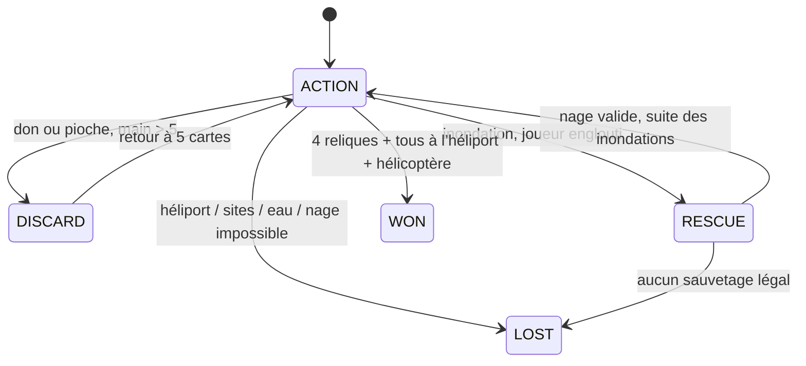

# Moteur d’expédition

Le moteur est une bibliothèque Java 17 sans Swing, DOM, réseau, horloge ou état global. La graine et les commandes déterminent la partie. La même classe `Engine` est exécutée sur JVM et compilée en JavaScript par TeaVM ; l’interface web ne décide jamais de la légalité d’une action.

## Architecture

```text
Desktop (Swing) ────────┐
                       ├── Engine ── Snapshot JSON
Bridge (@JSExport) ────┘       │
       │                      └── RNG déterministe, tuiles, mains, pioches, phases
       └── TeaVM ── web/generated/engine.js ── client DOM
```

Les mutations restent internes au package. Les interfaces reçoivent des vues non modifiables des listes et des accesseurs en lecture seule. Le protocole `command(String)` est la frontière de validation ; le résultat booléen et le message expliquent les refus. Les accesseurs `canMove`, `canShore`, `canNavigate`, `canRescue` et `canCapture` alimentent les contrôles activables.

Les commandes et le schéma JSON sont documentés dans [FRONTEND_HANDOFF.md](../FRONTEND_HANDOFF.md).

## Invariants

- Exactement 24 tuiles, deux sites par relique et un héliport.
- États de tuile `0 → 1 → 2` ; seule la transition `1 → 0` par assèchement est réversible. Une tuile engloutie ne revient jamais en jeu et sa carte Inondation est retirée.
- Au plus 3 actions par tour. L’Ingénieur peut encore utiliser son second assèchement gratuit à zéro action.
- 28 cartes Trésor au total dans les mains, la pioche et la défausse. Les cartes défaussées pour récupérer une relique restent dans le cycle.
- Les commandes invalides ne déplacent aucun pion et ne dépensent aucune carte ou action. Seuls le retour de validation et son message changent.
- Plusieurs aventuriers peuvent occuper la même tuile.
- Les reliques récupérées appartiennent à toute l’équipe.

## Machine à états



La fin du tour conserve deux compteurs : cartes Trésor restant à piocher et cartes Inondation restant à résoudre. Une défausse interrompt les pioches ; un sauvetage interrompt les inondations. Chaque choix reprend la phase suspendue, sans doubler la pioche ni changer prématurément de joueur. La pause bloque le protocole sans modifier ces compteurs.

## Talents

| Rôle | Règle implémentée |
|---|---|
| Exploratrice | Déplacement, assèchement et nage diagonaux. |
| Ingénieur | Deux assèchements consécutifs pour une action. Le second bonus expire lors d’une autre action ou en fin de tour. |
| Pilote | Un vol vers une tuile non adjacente par tour. Déplacements adjacents ordinaires toujours possibles. Nage vers toute tuile survivante. |
| Plongeur | Une traversée de tuiles inondées/englouties pour une action ; arrêt sur une tuile survivante. En urgence, rejoint un survivant à distance minimale via les tuiles englouties. |
| Messagère | Don d’une carte relique à n’importe quel équipier. |
| Navigateur | Déplace un autre joueur d’une ou deux tuiles survivantes ; diagonales admises pour l’Exploratrice. |

Cette édition pédagogique demande de résoudre les sauvetages avant les cartes spéciales et limite le talent Ingénieur à deux assèchements consécutifs. Ces choix sont explicitement annoncés dans l’aide. Aucun mode réseau, bot ou système de comptes n’est prétendu.

## Vérification

`EngineTest` couvre la création et la graine, les coûts d’action, les six rôles, les échanges et limites de main, la reprise d’une double défausse, les montées des eaux, la disparition irréversible, les cartes spéciales et leurs préconditions, la victoire et les quatre conditions de défaite, la pause et les commandes malformées. Un test supplémentaire simule 100 parties à graines fixes en contrôlant les invariants après chaque commande.

`ParityTrace` produit des traces JVM complètes sur plusieurs graines/difficultés. `tests/bridge-parity.test.mjs` rejoue les mêmes commandes dans le module TeaVM puis compare chaque champ de chaque snapshot. Cela vérifie notamment le RNG, le mélange, les rôles et les transitions compilées ; une seconde implémentation JavaScript ne se substitue pas au moteur testé.

`DesktopSmoke` exerce le vrai arbre Swing hors écran : sélection, activation du déplacement, mutation du moteur, coût de l’action, pause/reprise et rendu non vide. Les contrôles navigateur restent une validation complémentaire de l’interface, pas une preuve remplacée par les tests unitaires.

## Défauts du prototype corrigés

L’audit du commit original `5e1a1a0` a reproduit : artefact impossible à prendre sur la tuile du joueur, suppression qui laissait l’artefact présent, états de tuiles sous -1 redevenant traversables, assèchement gratuit même sans action, vérification du mauvais voisin, fin de tour sans notification, tirage d’inondation asymétrique, rendu demandant continuellement un autre rendu. La refonte remplace ces mécanismes ; les sources historiques ne sont pas retouchées.

## Pistes d’entretien technique

Expliquer pourquoi une commande invalide ne doit jamais muter partiellement l’état ; comment reprendre une phase interrompue ; pourquoi conserver un RNG déterministe ; comment le test de parité JVM/TeaVM évite deux jeux subtilement différents ; et pourquoi la séparation du moteur et des interfaces facilite les tests. Les résultats de parties simulées ne sont pas une mesure de difficulté équilibrée ni une stratégie optimale.
